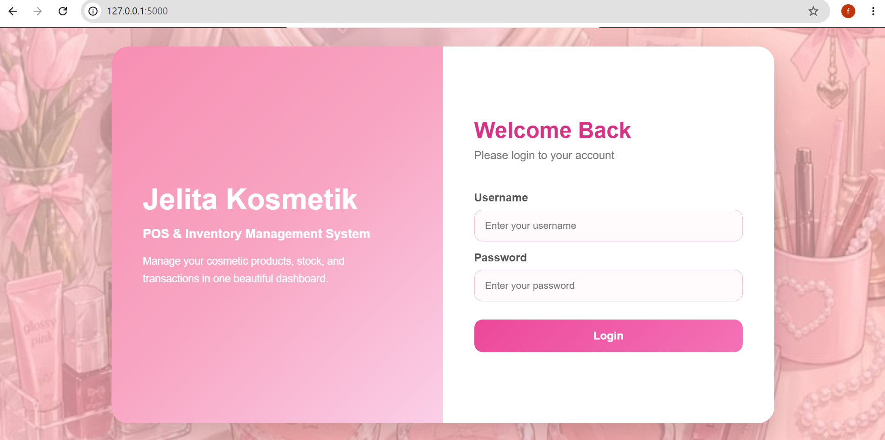
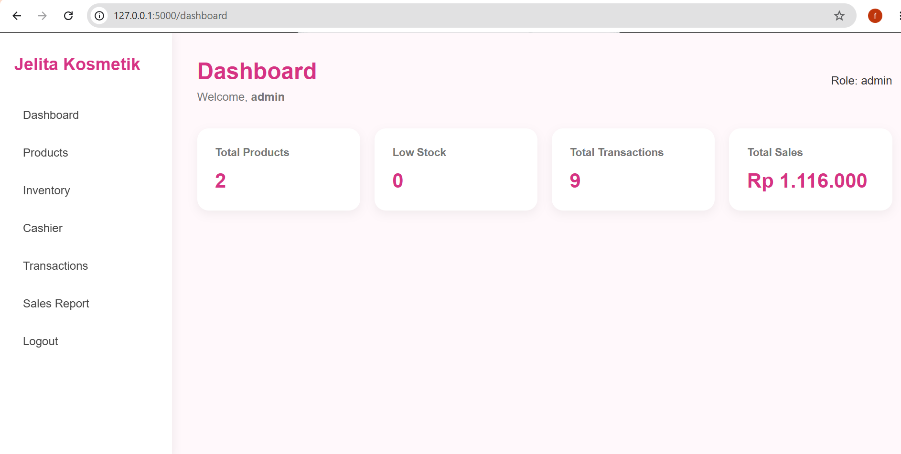
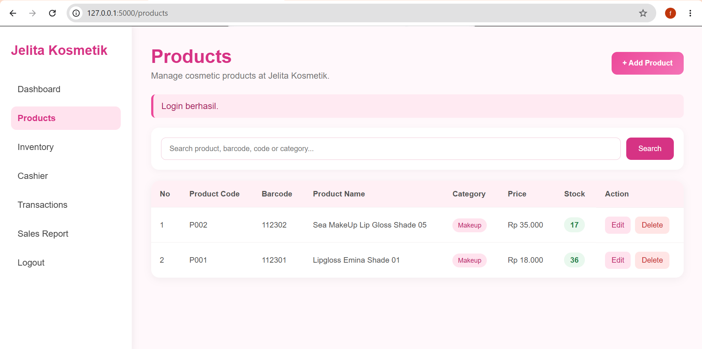
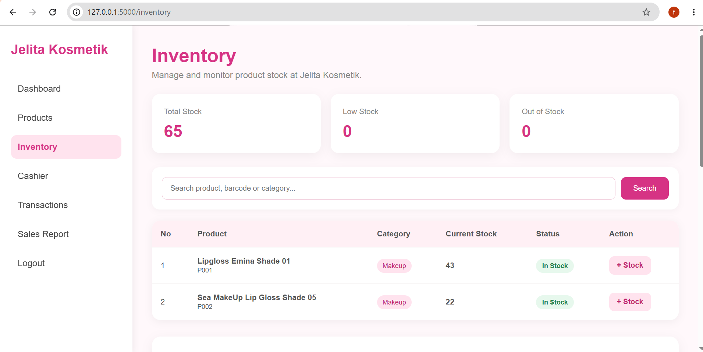
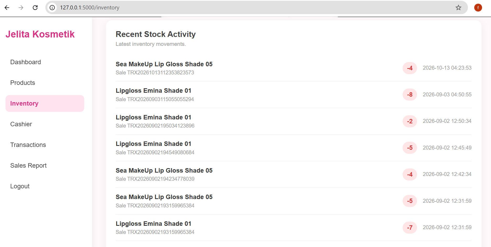
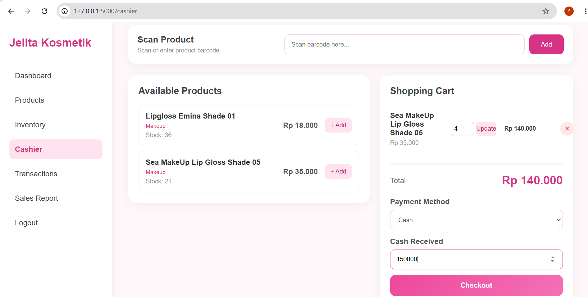
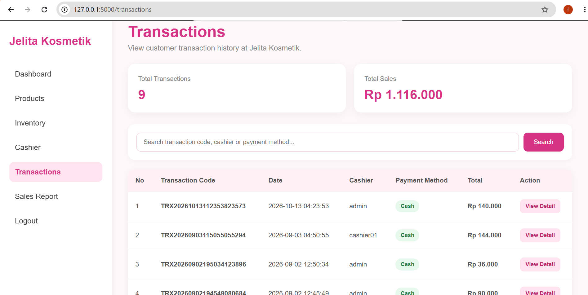
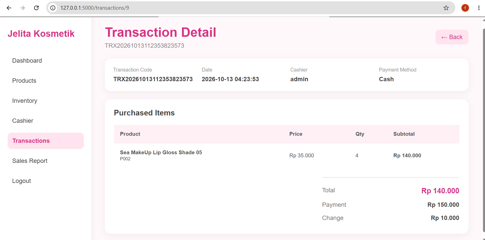
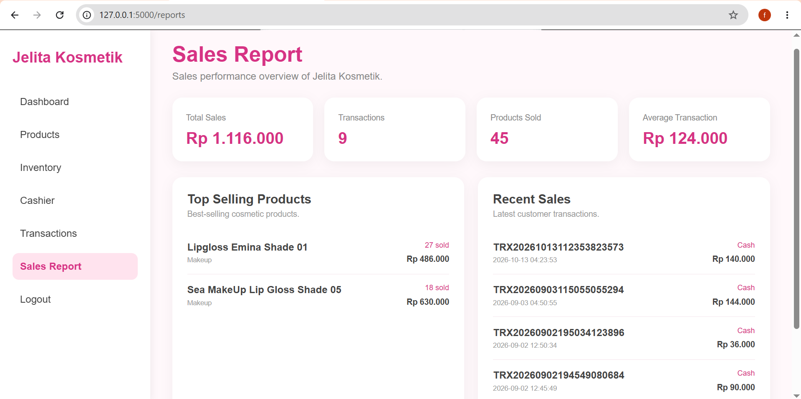
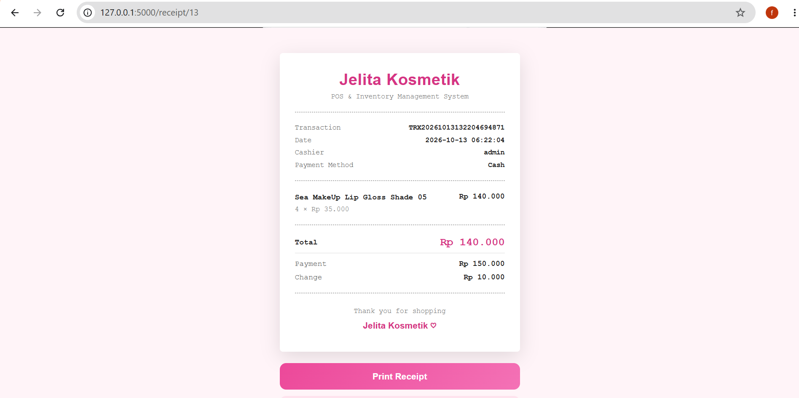

# Jelita Kosmetik — POS & Inventory Management System

A web-based Point of Sale (POS) and Inventory Management System developed using Python Flask and SQLite.

## Overview
Jelita Kosmetik is a personal web development project designed to support cashier transactions, product management, inventory monitoring, and sales reporting in a cosmetic retail store.
## Live Demo

Jelita Kosmetik is a web-based Point of Sale (POS) and Inventory Management System developed using Python Flask and SQLite.

The application provides features for product management, inventory tracking, sales transactions, receipt generation, and sales reporting.

**Live Application:** [Jelita Kosmetik POS & Inventory](https://fatimearr30.pythonanywhere.com)

**Demo Access:**
- Username: `demo_admin`
- Password: @Admin123

**Note:** This application is deployed for portfolio demonstration purposes. Please use sample data when exploring its features.

## Key Features
- Role-based login for Admin and Cashier
- Product and inventory management
- Barcode-based cashier transactions
- Automatic stock updates
- Transaction history
- Sales reports
- Printable transaction receipts

## Tech Stack
- Backend: Python, Flask
- Frontend: HTML, CSS, JavaScript
- Database: SQLite
- Development Tools: Visual Studio Code

## Project Status
Local development project. The application currently runs on localhost.


## Application Screenshots

Below are screenshots of the Jelita Kosmetik POS & Inventory Management System.

### 1. Login Page


### 2. Admin Dashboard


### 3. Product Management


### 4. Inventory Overview


### 5. Recent Stock Activity


### 6. Cashier & Checkout


### 7. Transaction History


### 8. Transaction Detail


### 9. Sales Report


### 10. Printable Receipt



## Getting Started

### Prerequisites
- Python 3.11 or a compatible version
- pip

### Installation

**1. Clone the repository**

```bash
git clone https://github.com/fatimearjbyh-prog/jelita-kosmetik-pos-inventory.git
cd jelita-kosmetik-pos-inventory
```

**2. Install dependencies**

```bash
python -m pip install -r requirements.txt
```

**3. Initialize the database**

```bash
python init_db.py
```

**4. Create a user account**

```bash
python create_user.py
```

Follow the terminal instructions to create an Admin or Cashier account.

**5. Configure the secret key**

In Windows PowerShell, run:

```powershell
$env:SECRET_KEY = python -c "import secrets; print(secrets.token_hex(32))"
```

**6. Run the application**

```bash
python app.py
```

**7. Open the application**

Visit http://127.0.0.1:5000 in your browser.

Log in using the account created in Step 4.

### Notes

- The application is designed to run locally.
- SQLite is used for database storage.
- Users create their own login credentials.
- The local database and secret key are not included in the repository.
## Author
Fatimah Arrajabiyah

Electrical Engineering Graduate | Aspiring Web Developer
  
